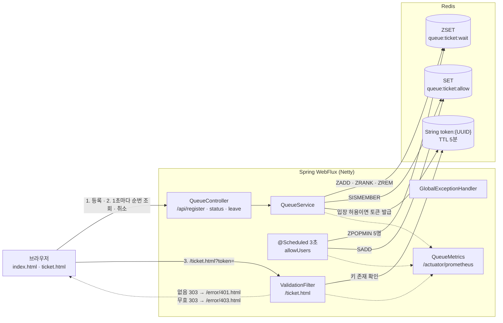

# LineUp — 트래픽 대기열 티켓 시스템

> 티켓 오픈처럼 접속이 한꺼번에 몰릴 때, 도착한 순서대로 줄을 세우고 정해진 인원만 입장 토큰을 받아 들어가게 하는 가상 대기열 서버입니다. **Spring WebFlux**와 **Reactive Redis**로 블로킹 없이 만들었습니다.

- 포트폴리오 상세: https://ji-geunyeong.kro.kr/projects/lineup
- 블로그: [1분에 100명씩 들여보내는 대기열: Redis ZSET과 WebFlux로 만든 LineUp](https://velog.io/@codes-gy/1분에-100명씩-들여보내는-대기열-Redis-ZSET과-WebFlux로-만든-LineUp)

## 1. 개요

티켓 오픈이나 한정판 상품 판매 때 생기는 **순간적인 대규모 동시 요청(Flash Traffic)** 이 예매/결제 같은 핵심 서비스로 바로 들어가지 않도록, 요청을 **Redis** 기반 대기열에 먼저 받아 둡니다. 순번이 된 사용자에게만 **진입 토큰(UUID, 5분)** 을 발급하고, 토큰이 있어야 예매 페이지에 들어갈 수 있습니다.

- 대기열 등록 · 순번 조회 · 이탈 API ([`QueueController`](src/main/java/com/api/tqt/ws/controller/QueueController.java))
- 3초마다 앞에서 5명씩 입장을 허용하는 스케줄러 (분당 약 100명)
- 5분짜리 입장 토큰 발급과 예매 페이지 보호 필터
- 브라우저는 오류 안내 페이지(401 · 403 · 404 · 500)로, API는 JSON으로 나눠 주는 오류 응답
- k6 부하 테스트 시나리오, Prometheus 지표 · 알림 규칙

## 2. 핵심 문제 해결

### ① 도착 순서대로 줄 세우기 — Redis ZSET

- **문제**: 오픈 순간 몰린 요청을 그대로 받으면 서버가 무너지고, 누가 먼저 왔는지도 지켜지지 않는다.
- **원인**: 요청이 들어오는 대로 핵심 서비스에 닿아, 들어가는 양을 조절할 장치가 없다.
- **해결**: 등록 시각(epoch ms)을 점수로 `ZADD`해 도착 순서를 지키고, 순번은 `ZRANK`로 바로 계산한다. 3초마다 `ZPOPMIN`으로 앞에서 5명을 꺼내 입장 허용 집합(`SADD`)으로 옮긴다. 대기를 취소하면 `ZREM`으로 바로 빼 뒤 사람들의 순번이 당겨진다. → [`QueueService.java`](src/main/java/com/api/tqt/ws/service/QueueService.java)
- **결과**: 입장은 분당 약 100명(3초마다 5명, 코드의 설정값)으로 일정하고, 나머지는 대기 화면([`index.html`](src/main/resources/static/index.html))에서 1초마다 자기 순번을 확인하며 기다린다.

### ② 입장 토큰으로 예매 페이지 지키기

- **문제**: 대기열을 거치지 않고 예매 페이지 주소로 바로 들어오면 줄 세우기가 의미 없어진다.
- **해결**: 입장이 허용된 사용자에게만 `token:{UUID}` 키를 Redis에 5분 TTL로 발급한다. `WebFilter`가 `/ticket.html` 요청마다 토큰을 확인해, 없으면 `/error/401.html`, 만료되거나 잘못된 토큰이면 `/error/403.html`로 `303` 리다이렉트한다. → [`ValidationFilter.java`](src/main/java/com/api/tqt/ws/config/ValidationFilter.java)
- **결과**: 토큰 없이 들어온 요청은 예매 페이지에 닿지 못한다. 세 경우(토큰 없음 · 무효 · 유효)를 [`ValidationFilterTest.java`](src/test/java/com/api/tqt/ws/config/ValidationFilterTest.java)로 확인한다.

### ③ 블로킹 없이 처리하고 부하로 확인

- **문제**: 대기열 서버 자체가 몰린 요청에 막히면 줄을 세울 수도 없다.
- **해결**: 등록 · 조회 · 이탈 전 과정을 `ReactiveRedisTemplate`과 `Mono`로 이어 블로킹 호출을 없앴다. 스케줄러도 구독만 하고 바로 반환해 스케줄러 스레드를 막지 않는다.
- **측정 방법**: Grafana k6 ([`load-test.js`](load-test.js)). 최고 인원(`PEAK`)까지 가상 사용자를 늘렸다 줄이는 50초 동안 대기열 등록(`POST /api/register`)과 순번 조회(`GET /api/status`)를 1초 간격으로 반복한다.
    - 10초 동안 최고 인원의 1/6까지 → 30초 동안 최고 인원까지 → 10초 동안 0명
    - 최고 인원 300 · 1,000 · 3,000 · 5,000명으로 네 번 실행 (`k6 run -e PEAK=5000 load-test.js`), 실행마다 Redis를 비움
    - 목표: 요청 실패율(`http_req_failed`) 1% 미만, 95% 응답 시간(`http_req_duration p(95)`) 200ms 미만
- **결과**:

| 최고 인원 | 총 요청 수 | 초당 요청 | 평균 응답 | 95% 응답 | 최대 응답 | 실패율 | 달성 여부 |
| :--- | ---: | ---: | ---: | ---: | ---: | ---: | :---: |
| 300 VUs | 7,276건 | 147.3 | 1.31 ms | **2.43 ms** | 17.79 ms | **0.00%** | PASS |
| 1,000 VUs | 24,294건 | 479.8 | 1.04 ms | **1.47 ms** | 19.03 ms | **0.00%** | PASS |
| 3,000 VUs | 72,852건 | 1,472.3 | 1.39 ms | **2.20 ms** | 63.09 ms | **0.00%** | PASS |
| 5,000 VUs | 121,420건 | 2,454.5 | 1.61 ms | **3.25 ms** | 38.85 ms | **0.00%** | PASS |

- 가상 사용자 5,000명 실행에서도 요청 121,420건을 **실패 0건**으로 처리했습니다.
- 인원을 300명에서 5,000명으로 약 17배 늘리는 동안 95% 응답 시간은 모두 **4ms 이내**로, 목표(200ms 미만)를 크게 밑돌았습니다.
- 초당 요청이 인원에 비례해 늘어(5,000명에서 초당 약 2,454건), 이 범위에서는 처리 한계에 닿지 않았습니다.

<details>
<summary><b>k6 로그 접기/펼치기 (최고 인원 5,000명)</b></summary>

```text
  █ THRESHOLDS 

    http_req_duration
    ✓ 'p(95)<200' p(95)=3.25ms

    http_req_failed
    ✓ 'rate<0.01' rate=0.00%


  █ TOTAL RESULTS 

    checks_total.......: 121420  2454.489709/s
    checks_succeeded...: 100.00% 121420 out of 121420
    checks_failed......: 0.00%   0 out of 121420

    ✓ 등록 성공 (HTTP 200)
    ✓ 순번 조회 성공 (HTTP 200)

    HTTP
    http_req_duration..............: avg=1.61ms min=32.81µs med=1.14ms max=38.85ms p(90)=2.15ms p(95)=3.25ms
      { expected_response:true }...: avg=1.61ms min=32.81µs med=1.14ms max=38.85ms p(90)=2.15ms p(95)=3.25ms
    http_req_failed................: 0.00%  0 out of 121420
    http_reqs......................: 121420 2454.489709/s

    EXECUTION
    iteration_duration.............: avg=2s     min=2s      med=2s     max=2.04s   p(90)=2s     p(95)=2s    
    iterations.....................: 60710  1227.244854/s
    vus............................: 181    min=64          max=4967
    vus_max........................: 5000   min=5000        max=5000

    NETWORK
    data_received..................: 17 MB  343 kB/s
    data_sent......................: 13 MB  270 kB/s
```
</details>

## 3. 아키텍처



- 대기 화면은 `/api/status` 응답이 `ALLOWED`이고 토큰이 오면 `/ticket.html?token=...`으로 넘어갑니다.
- 오류는 [`GlobalExceptionHandler`](src/main/java/com/api/tqt/ws/error/GlobalExceptionHandler.java)가 `Accept: text/html` 요청이면 `303`으로 `/error/404.html` · `/error/500.html`로 보내고, 그 밖의 요청에는 JSON으로 응답합니다.

## 4. 기술 스택

| 구분 | 기술 | 고른 이유 |
| --- | --- | --- |
| 언어 · 빌드 | Java 21, Gradle (Kotlin DSL) | |
| 프레임워크 | Spring Boot 4.1.0, Spring WebFlux (Netty) | Non-blocking I/O로 적은 스레드로 많은 동시 접속을 받기 위해 |
| 저장소 | Redis (Reactive, Lettuce) — 로컬 또는 Upstash | Sorted Set(ZSET)으로 도착 순서와 순번을 바로 계산하기 위해 |
| 관측성 | Spring Boot Actuator, Micrometer(Prometheus) | |
| 부하 테스트 | Grafana k6 | |

## 5. 실행 방법

필요한 것: JDK 21, Redis. Redis 접속 정보는 환경변수로 넣습니다. 값이 없으면 로컬 Redis(`localhost:6379`)에 붙습니다 ([`application.yaml`](src/main/resources/application.yaml)).

| 환경변수 | 기본값 | 설명 |
| --- | --- | --- |
| `REDIS_HOST` | `localhost` | Redis 호스트 |
| `REDIS_PORT` | `6379` | Redis 포트 |
| `REDIS_PASSWORD` | (없음) | Redis 비밀번호 |
| `REDIS_SSL` | `false` | Upstash 등 TLS가 필요한 Redis는 `true` |
| `PORT` | `8080` | 서버 포트 |

```bash
# 로컬 Redis
./gradlew bootRun

# Upstash
REDIS_HOST=<host>.upstash.io REDIS_PASSWORD=<password> REDIS_SSL=true ./gradlew bootRun

# 대기 화면: http://localhost:8080/

# 부하 테스트 (k6 설치 필요, PEAK 기본 300, BASE_URL 기본 http://localhost:8080/api)
k6 run -e PEAK=5000 load-test.js
```

## 6. 테스트

```bash
./gradlew test
```

2026-11-25 기준 테스트 파일 4개, 테스트 15개 (로컬에서 Redis 없이 실행해 모두 통과).

| 파일 | 개수 | 확인하는 것 |
| --- | ---: | --- |
| [`ValidationFilterTest`](src/test/java/com/api/tqt/ws/config/ValidationFilterTest.java) | 3 | 토큰 없음 → 401 페이지, 만료 · 무효 토큰 → 403 페이지, 유효한 토큰 → 통과 (거절 지표 집계 포함) |
| [`QueueServiceMetricsTest`](src/test/java/com/api/tqt/ws/service/QueueServiceMetricsTest.java) | 7 | 입장 스케줄러 한 틱의 성공 · 실패에 따른 입장 수 · 마지막 성공 시각 기록, 대기 인원 게이지, 오류가 나도 스케줄러가 예외를 던지지 않음 |
| [`QueueMetricsTest`](src/test/java/com/api/tqt/ws/metrics/QueueMetricsTest.java) | 4 | 카운터 · 게이지 · 거절 사유 태그 |
| [`WatingSystemApplicationTests`](src/test/java/com/api/tqt/ws/WatingSystemApplicationTests.java) | 1 | 컨텍스트 기동 |

단위 테스트는 Redis를 목(mock)으로 대체합니다. 실제 Redis에 붙인 대기열 흐름과 처리량은 위의 k6 부하 테스트로 확인했습니다.

## 7. 운영 · 관측성

Spring Boot Actuator + Micrometer(Prometheus)로 지표를 내보냅니다. 외부에는 `GET /actuator/health`(Redis 연결 포함), `GET /actuator/prometheus` 두 엔드포인트만 열어 둡니다.

| 지표 (Prometheus 이름) | 종류 | 설명 |
| --- | --- | --- |
| `lineup_queue_waiting` | gauge | 대기 인원. 5초마다 `ZCARD`로 측정한 값을 보여줌 (게이지 안에서 Redis를 조회하지 않음) |
| `lineup_queue_admitted_total` | counter | 입장 허용된 사용자 수 (스케줄러가 꺼낸 인원) |
| `lineup_scheduler_last_success_timestamp_seconds` | gauge | 입장 스케줄러가 마지막으로 오류 없이 끝난 시각 (epoch 초) |
| `lineup_entry_rejected_total{reason,status}` | counter | 진입 토큰 거절 수. `reason="missing",status="401"`(토큰 없음), `reason="invalid",status="403"`(만료·위조) |
| `http_server_requests_seconds_bucket{uri,...}` | histogram | 엔드포인트별 응답 시간 (p95 계산용 버킷 포함) |
| `lettuce_seconds_bucket{db_operation,error,...}` | histogram | Redis 명령별 지연. Boot가 Lettuce에 Micrometer Observation을 자동으로 붙여 만들어 줌 |

> 진입 필터는 거절할 때 `303` 리다이렉트로 응답하므로, 401/403은 `http_server_requests`가 아니라 `lineup_entry_rejected_total`로 봅니다.

알림 규칙 ([`monitoring/prometheus-alerts.yml`](monitoring/prometheus-alerts.yml)):

| 알림 | 조건 | 의미 |
| --- | --- | --- |
| `LineUpSchedulerStalled` | 5분간 대기 인원 증가 & 입장 0명, 5분 지속 | 입장 스케줄러가 멈췄거나 계속 실패 |
| `LineUpSchedulerLastSuccessStale` | 마지막 성공 후 30초 초과, 30초 지속 | Redis 연결 끊김 또는 스케줄러 정지 |
| `LineUpAdmissionRateTooHigh` | 입장 속도 분당 110명 초과, 5분 지속 | 설계치(3초마다 5명 = 분당 100명)를 넘음 → 여러 인스턴스에서 스케줄러가 중복 실행 |
| `LineUpHighP95Latency` | 엔드포인트별 p95 > 200ms, 5분 지속 | 부하 테스트 목표(200ms) 초과 |
| `LineUpEntryRejectionSpike` | 401/403 거절 분당 60건 초과, 5분 지속 | 우회 접근 시도 또는 토큰 만료(TTL 5분) 문제 |
| `LineUpRedisCommandErrors` | 오류로 끝난 Redis 명령 발생, 2분 지속 | Redis 명령 실패 (연결 자체가 끊긴 경우는 `LineUpSchedulerLastSuccessStale`이 잡음) |
| `LineUpRedisSlowCommands` | Redis 명령별 p95 > 50ms, 5분 지속 | Redis 서버 부하·네트워크 지연 |

<details>
<summary><b>Prometheus 수집 설정 · 규칙 문법 검사</b></summary>

```yaml
# prometheus.yml
rule_files:
  - prometheus-alerts.yml
scrape_configs:
  - job_name: lineup
    metrics_path: /actuator/prometheus
    static_configs:
      - targets: ['localhost:8080']
```

```bash
docker run --rm -v "$PWD/monitoring":/w --entrypoint promtool prom/prometheus check rules /w/prometheus-alerts.yml
```
</details>

## 8. 폴더 구조

```text
src/main/java/com/api/tqt/ws/
├── controller/QueueController.java   # 등록 · 순번 조회 · 이탈 API
├── service/QueueService.java         # ZSET 대기열, 입장 스케줄러, 토큰 발급
├── config/ValidationFilter.java      # /ticket.html 진입 토큰 검사
├── config/RedisConfig.java           # ReactiveRedisTemplate<String, String>
├── error/GlobalExceptionHandler.java # 브라우저는 안내 페이지, API는 JSON
└── metrics/QueueMetrics.java         # 대기 · 입장 · 거절 지표
src/main/resources/static/            # 대기 화면, 예매 페이지, 오류 안내 페이지
load-test.js                          # k6 시나리오
monitoring/prometheus-alerts.yml      # 알림 규칙
```

## 9. 한계 · 아직 안 한 것

- 입장 스케줄러는 인스턴스마다 돌기 때문에 여러 인스턴스로 띄우면 중복 실행됩니다. 지금은 `LineUpAdmissionRateTooHigh` 알림으로 감지만 합니다.
- 알림 임계값은 부하 테스트 결과와 스케줄러 설정에서 정한 초기값이라, 운영 트래픽을 보고 조정해야 합니다.
- k6 시나리오는 등록과 순번 조회만 부르며, 예매 페이지 진입(토큰 검사) 구간은 부하 테스트에 들어 있지 않습니다.
